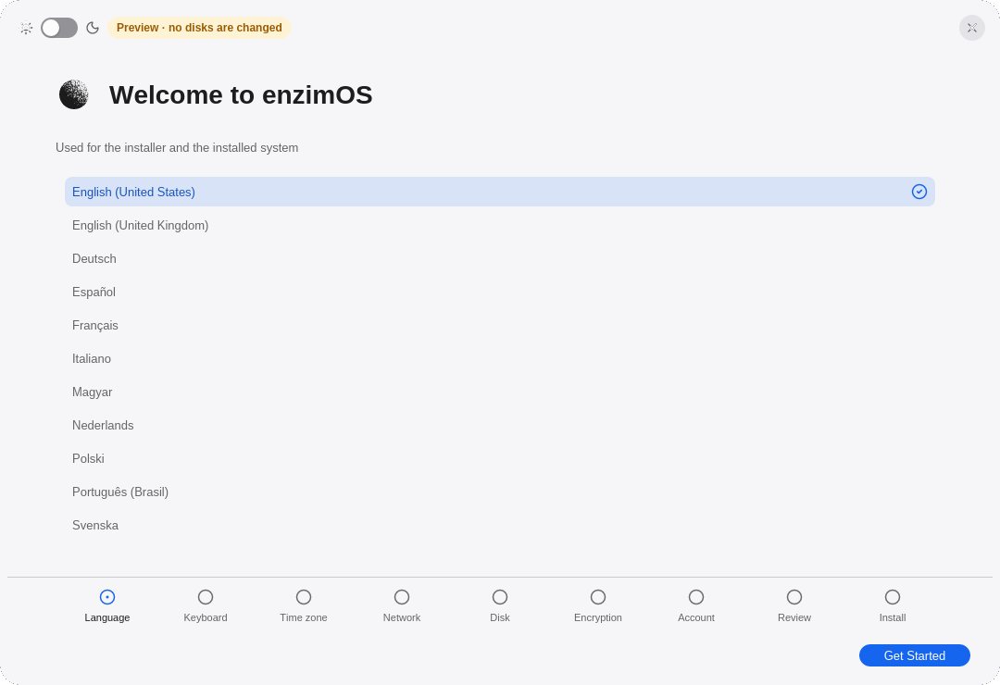
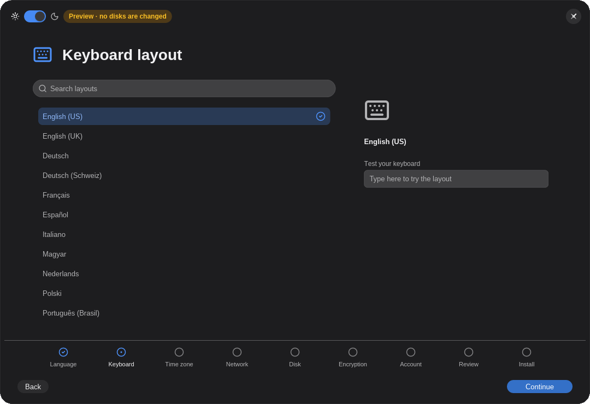
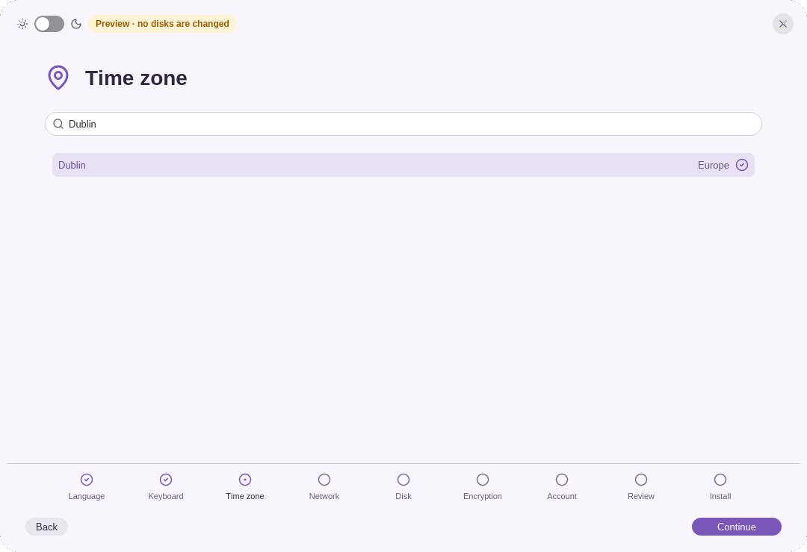
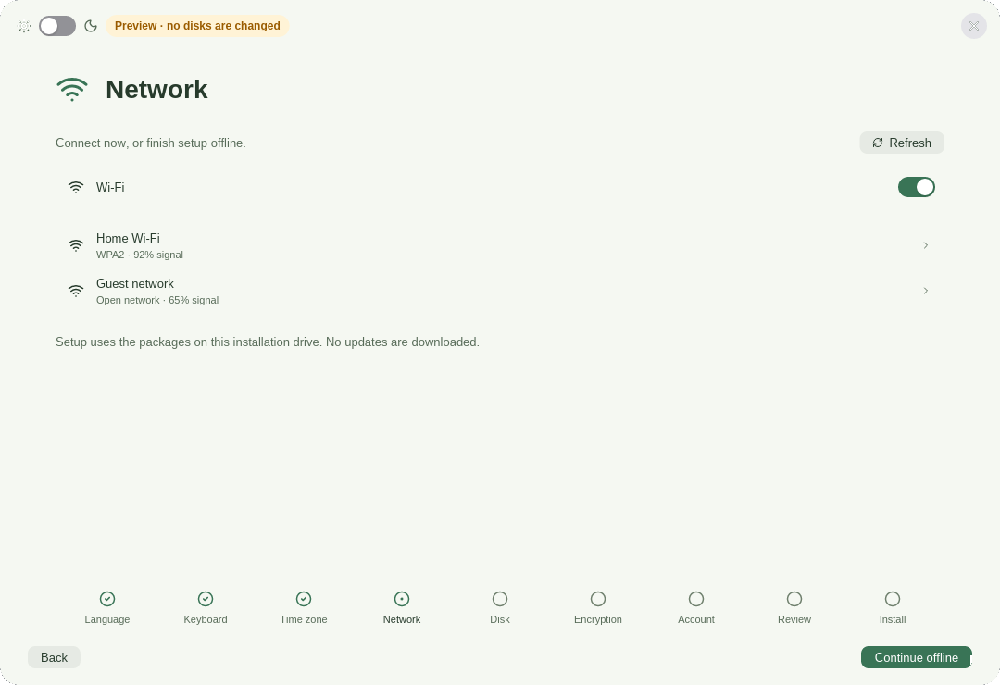
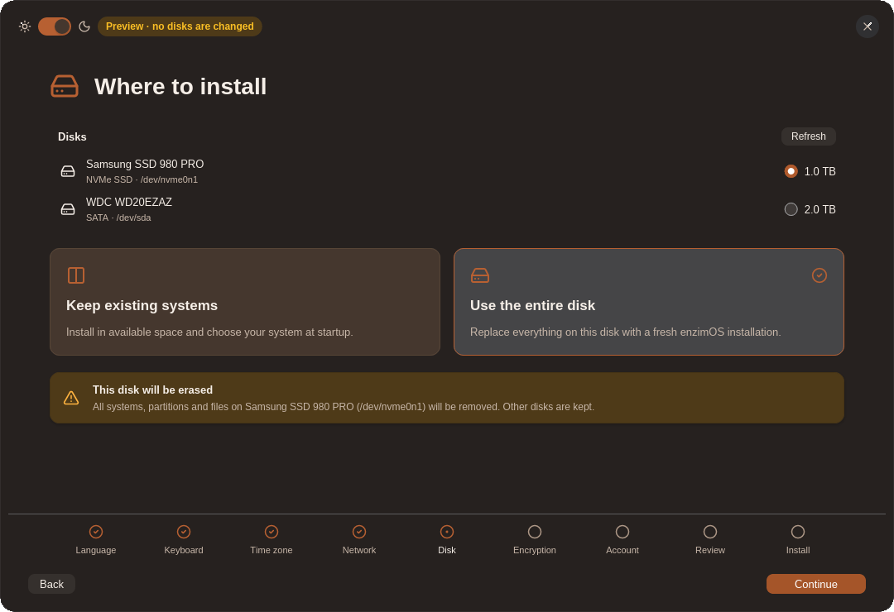
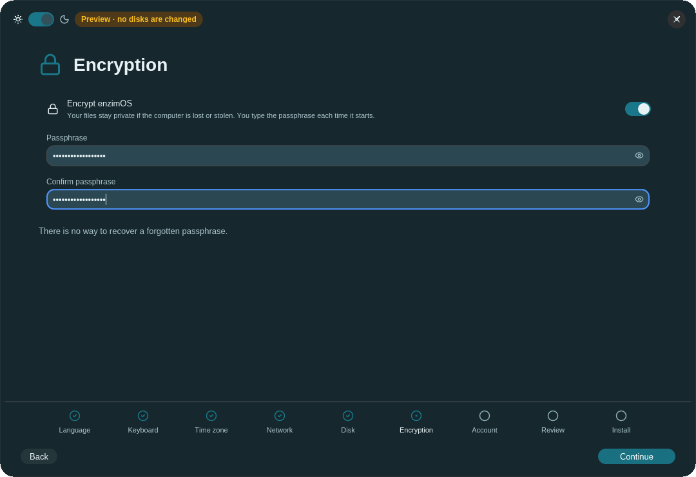
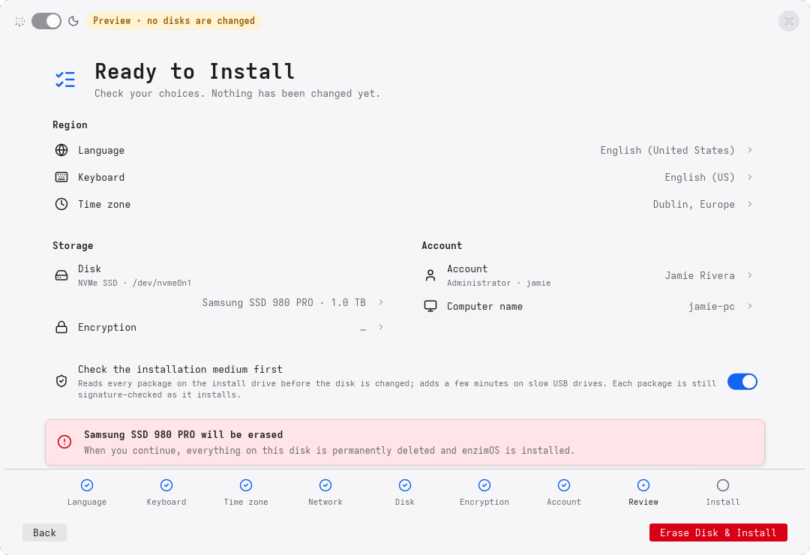
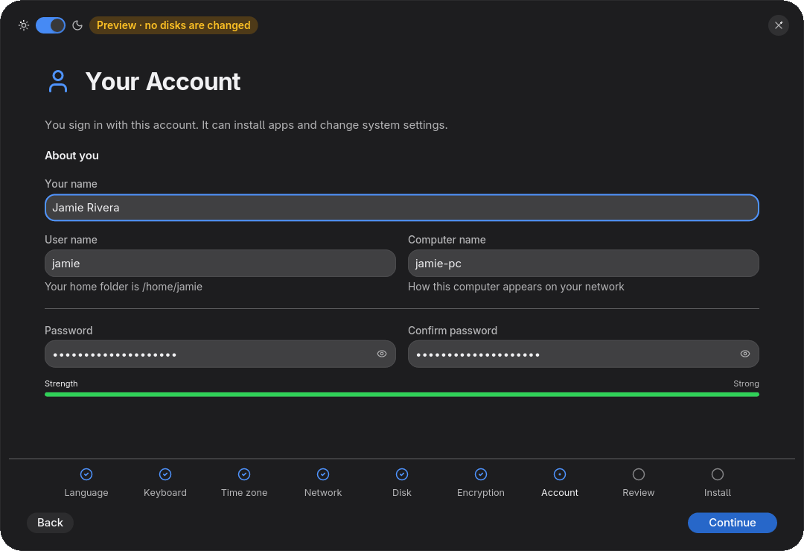

# enzimOS Installer

The graphical installer guides you through language, keyboard, network, storage,
encryption and account setup. Review the plan before starting installation, then
follow progress and open the installation log if needed.

<table>
  <tr>
    <td align="center"><a href="docs/screenshots/basic-light.png"></a><br><sub>Language · light</sub></td>
    <td align="center"><a href="docs/screenshots/basic-dark.png"></a><br><sub>Keyboard · dark</sub></td>
    <td align="center"><a href="docs/screenshots/lavender.png"></a><br><sub>Time zone</sub></td>
    <td align="center"><a href="docs/screenshots/sage.png"></a><br><sub>Network</sub></td>
  </tr>
  <tr>
    <td align="center"><a href="docs/screenshots/ember.png"></a><br><sub>Disk selection</sub></td>
    <td align="center"><a href="docs/screenshots/lagoon.png"></a><br><sub>Encryption</sub></td>
    <td align="center"><a href="docs/screenshots/precision.png"></a><br><sub>Final review</sub></td>
    <td align="center"><a href="docs/screenshots/comfort.png"></a><br><sub>Account</sub></td>
  </tr>
</table>

## Build and preview

The repository selects Rust 1.99.1 and supports Rust 1.95 or newer. Build on
Linux with a C/C++ toolchain,
pkg-config, Wayland, XKB, GLib/GIO, fontconfig and graphics development libraries.
Cargo uses the public enzUI and foundation commits pinned in the lockfile.

```sh
cargo run --locked -- --demo
```

Demo mode uses sample disks and network entries. It never starts the installer
backend or partitions a disk.

Installation requires the enzimOS live environment and the native installer
backend. The frontend submits answers, including passwords and passphrases,
through the helper's standard input.

[enzimOS Installer Backend](https://github.com/enz1m/enzimos-installer)

## Development

```sh
cargo fmt --all -- --check
cargo test --locked --workspace --all-targets
cargo clippy --locked --workspace --all-targets -- -D warnings
```

Shared desktop themes apply through enzUI. Translations live in
[`assets/locales/`](assets/locales/). See [CONTRIBUTING.md](CONTRIBUTING.md) for
native workflow checks.

## License

[MIT](LICENSE)
